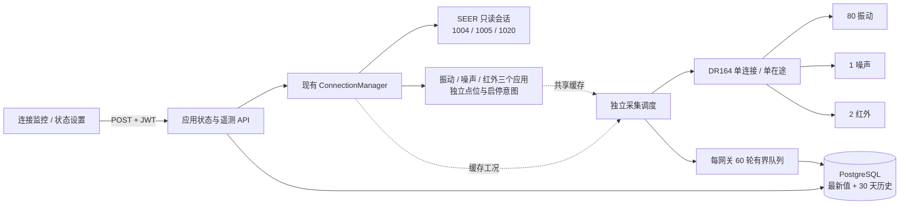

# 仙工 AGV 只读状态与三传感器连续采集

本次实施对应 [对接方案](plans/2026-11-12-agv-motion-sensor-integration-plan.md) 的 M1、连续监测部分及管理页面。用户确认先监测 AGV 自身、预留到站采集；三个外设先采用说明书默认档案。导航、顶升、控制权抢占、暂停/恢复动作尚未开放。

## 当前链路



每车一个 `device_type=agv` 应用，协议为通用 `tcp`，应用适配器为 `seer_agv`；振动、噪声、红外温度三个应用同样使用 `tcp`，应用适配器为 `dr164_sensor`，通过 V23 的 `wcs_sensor_application` 关联同一采集网关。网关的 `agv_app_id` 仅用于工况关联。三个逻辑应用各自设置连接意图，调度器最多 5 秒内更新活动从站；关闭一个应用不会关闭其他从站共用的 TCP，全部关闭才停止总线。连续采集不创建 WCS 任务、不写 PLC 握手位。页面查询只读缓存和数据库，不触发额外总线读取。V24 将旧专用协议分类归并为 TCP，报文与共享采集逻辑由应用适配器负责，见 [协议与应用适配器](dashboard-and-application-adapters.md#协议与应用适配器)。

首期支持单个 WCS 执行实例；最多配置 32 个采集网关，不提供多实例主站选举。同一物理网关只能由一个实例轮询，部署时避免将同一端点配置为不同 DNS/IP 别名。

## 仙工状态合同

| 字段 | API | 必须有效的字段 |
| --- | --- | --- |
| `seer_location` | 1004 | x、y、angle 有限数值 |
| `seer_speed` | 1005 | vx、vy、w 有限数值 |
| `seer_navigation` | 1020 | task_status 整数 0–6 |

AGV v2 发布协议含 40 个业务状态点位及 3 个内部报文点位。业务字段分为 `loc_*`、`speed_*`、`nav_*`，使用数值、布尔、字符串或数组类型，中文名称及单位来自 [SeerPointCatalog](../backend/src/main/java/com/cayleywcs/adapter/seer/SeerPointCatalog.java)。固件未提供或类型不匹配的可选字段为 null / UNKNOWN；不填零。每轮仍仅查询 1004、1005、1020 各一次。

三个内部 STRING 点位保留 `api / sequence / headerMode / receivedAt / payload` JSON 封套，供诊断和采集工况使用。旧 v1 三报文合同仍可读取；`/agv/upgrade` 创建新的已发布协议并切换现有应用，保留应用 ID、凭据、原协议快照及连接意图。1020 的“完成”只展示设备状态，不被解释为 WCS 业务任务完成。

## 应用、点位与状态设置

| 应用类型 | 业务点位 | 权限 |
| --- | --- | --- |
| 仙工 AGV / agv | 位置、站点、定位状态、速度、导航任务等 40 项 | 只读 |
| 振动传感器 / vibration_sensor | 三轴振动速度、三轴位移、三轴频率、芯片温度，共 10 项 | 只读 |
| 噪声传感器 / noise_sensor | noise：噪声声级 | 只读 |
| 红外温度传感器 / infrared_sensor | infrared_temperature：红外测量温度 | 只读 |

三个传感器协议的字段、中文名称、单位及原生映射定义在 [SensorPointCatalog](../backend/src/main/java/com/cayleywcs/telemetry/profile/SensorPointCatalog.java)。红外映射引用网关档案的零基寄存器选择，避免两个配置源漂移。网关地址未配置时，应用及点位仍可查看，值显示缺测及“待配置采集端点”。

[连接监控](../frontend/src/views/ConnectionView.vue) 展示所有下位应用，包括未连接应用。“状态设置”支持切换应用、筛选点位、查看当前值/质量/接收时间和上次有效值；内部诊断点位可展开。读取缓存每 2 秒刷新。业务 response 点位只读；业务 request 点位才具备设置能力，内部控制点不在此处编辑。设置还要求当前版本、启用状态、维护模式、无活动任务/遗留任务号及设备物理空闲。后台在同一设备锁内重新检查，旧版本页面不能提交到新版本设备。命令点没有回读时明确显示“未提供回读”，提交值不伪装为设备当前状态。

状态设置采用分区卡片面板，不再使用点位表格与批量勾选。AGV 分为定位与站点、运动状态、导航任务；振动分为速度、位移、频率和芯片温度，其余传感器显示各自测量数据。每个卡片显示中文名称、当前值、单位、质量、接收时间和权限，保留编码与类型说明。界面分区仅用于展示，不恢复已移除的协议分组配置。

可写点位通过卡片旁的“设置”单独编辑：数值输入、布尔是/否、枚举选择、文字输入和数组输入分别对应参数类型；64 位十进制字符串直接输入整数并无损提交。前端提示类型、范围、数组长度等错误，后台继续按发布契约校验。设置失败保留输入；刷新中断或权限变化立即禁止提交；发布版本或配置代次变化关闭旧窗口并提示重开。自动门的开/关点位有成对互斥约束，编辑其中一项会明确提示联动另一项和本次动作，提交时携带一组 0/1 值。实现见 [`PointStatePanels`](../frontend/src/components/PointStatePanels.vue)、[`PointValueEditor`](../frontend/src/components/PointValueEditor.vue) 和 [`statePoints`](../frontend/src/utils/statePoints.ts)。

原 AGV 独立菜单已合并；旧 `#/agv` 路由跳转连接监控。接入、网关档案、供电记录及历史位于 [AgvCollectionPanel](../frontend/src/components/AgvCollectionPanel.vue)。已有网关先停用旧式采集，再创建三个应用；拆分后从连接监控分别启动采集，原网关 enable 接口拒绝重复管理。更改共享档案前须关闭三个应用。

响应按 16 字节头、UTF-8 字节长度、序号、对应响应 API、完整 JSON、ret_code 和必要字段校验；上限 64 KiB。默认要求显式 `ret_code=0`。整笔截止时间内未收到完整帧即断开旧代次；不接受错误 API/序号、超长帧、非有限数值、重复 JSON 键或尾随内容。

本车 2026-11-12 实测：响应头第 10–11 字节回显请求 API，后四字节为零。适配器同时接受这个已核实格式与六字节全零的历史格式，不任意忽略保留区。请求保留区仍全部填零。实际状态已通过协议客户端读取；真实后台链路验证见 [实施日志](../.logs/2026-11-12-agv-readonly-telemetry-implementation.md)。

当前会话仅允许上述三个查询。协议发布、任务准入、选机与适配器写入口均限制为只读；没有动作端口或导航参数入口。地图同步、原生任务关联、执行意图与不确定结果恢复属于后续导航闭环。

## 三传感器默认档案

下列是用户授权采用的初始档案，不代表硬件已完成参数写入。采集程序只发功能码 03，不自动更改从站地址、串口波特率、网关参数或传感器寄存器。

| 设备 | Unit ID | 零基地址 / 数量 | 换算 |
| --- | --- | --- | --- |
| WTVB01-485 | 80 / 0x50 | 0x003A × 3 | XYZ 速度 u16 / 100 mm/s |
| WTVB01-485 | 80 / 0x50 | 0x0040 × 7 | 芯片温度 /100 ℃；XYZ 位移 u16 μm；XYZ 频率 /10 Hz |
| RS-ZS-N01-BK | 1 | 0x0000 × 1 | u16 / 10 dB；有效范围 30–130 |
| RS-WD-HW-N01-2 | 2 | 默认 0x0000 × 1 | u16 / 10 ℃；暂定 0–600 ℃ |

说明书列有红外寄存器 0/1 和多个量程版本；默认选择 0、0–600 ℃，可停用采集后改档案。不会遇到错误就交替读两个温度寄存器。红外的真实量程、安装、发射率和批读支持仍需按实物核对。

DR164 目标设置：Wi-Fi STA、TCP Server、Modbus TCP 转 RTU、9600 / 8N1、单主站。说明书没有指定现场 IP 和监听端口，因此代码不会虚构可连接地址。可以先保存未配置端点的网关档案；启动采集前必须存在实际运行端点。

芯片温度负值编码未确认，原字最高位为 1 时保留 raw、value=null、quality=UNKNOWN。噪声不标记为 dBA/Leq；振动值不自行标记为 RMS。

## 采集、质量与数据保存

- 正常目标每 2 秒一轮，四笔事务相邻间隔从前一笔结束计至少 250 ms；请求绝对截止时间默认 1 秒，可配置 100–10000 ms。过期周期跳过，不补发积压查询。
- 建立采集运行态后先静默 2 秒；超时或协议错误关闭旧 TCP、终止本轮后续事务，静默至少 2 秒加抖动后恢复。失败块独立退避，三次失败后每 10 秒探测；恢复从下一个块开始，健康从站可继续采集。实际串口迟到应答能否在 2 秒内排空仍须用 DR164 台架验证。
- Modbus 校验 MBAP 协议号、TID、Unit ID、长度、功能码和数据字节数；16 位寄存器无符号解码。仅允许上述四个读块；无隐藏心跳读、无写功能、无内部自动重试。
- 现有 `Plc4xAdapter` 使用通用单点读写、连接级锁与 future 等待，不能直接提供本模块所需的关闭超时代次和逐包校验边界。本阶段为传感器总线新增最小 FC03 传输器，保留原 PLC4X 路径不变；未宣称 PLC4X 本身不支持多站号。
- 每个指标保留 raw、value、unit、quality、receivedAt、profileVersion、缓存工况和工况年龄。时间采用服务器接收/观察时间；没有设备采样时间，不宣称四块同时采样。
- GOOD / WARMING_UP / WARMUP_UNKNOWN / UNKNOWN / OUT_OF_RANGE / TIMEOUT / PROTOCOL_ERROR 与网关 ONLINE / DEGRADED / OFFLINE 独立。未采集值不是 0；失败后的当前值与 lastGood 分开。
- 超 6 秒未更新显示 STALE，前端在 HTTP 失联时也随时间推移标旧值。传感器健康按 Unit ID 汇总；通信正常但红外预热未知仍不能作为有效温度。
- 红外至少 40 分钟预热。供电时间默认未知；只有显式填写可信上电时间及来源才开始计算。Wi-Fi 重连、WCS 重启不自动重置或伪造供电记录。修改网关端点引用会清除原供电记录；硬件更换或供电中断后应重新登记。
- 8 个独立网络工作线程，2 个存储线程；每网关最多缓存 60 轮。队列满丢弃新历史轮次并累计 dropped，实时缓存仍更新。数据库失败保持队首等待恢复，记录 RETRYING；进程退出会丢失未持久化队列，离线期间没有车载补传保证。
- 最新值表每指标一行，历史每轮一行 JSON。周期 UUID 防重复入库，配置版本防旧工作线程覆盖新档案。默认清理超过 30 天的历史；历史查询按 id 游标，每页最多 100 轮、每次时间范围最多 7 天。
- 本阶段只展示质量与通信健康，不发布温度/噪声/振动阈值报警，也不把传感器作为运动安全联锁。

## 接入步骤

运行环境通过 Spring 配置提供端点；实际地址不得写入版本库。每个端点归属由 tenant-id 约束，默认固定归属 1，其他归属不能通过另建应用使用该端点。键名为：

```text
cayleywcs.endpoints.<引用名>.host
cayleywcs.endpoints.<引用名>.port
cayleywcs.endpoints.<引用名>.timeout-ms
cayleywcs.endpoints.<引用名>.tenant-id
```

当前机器的现有 AGV 引用名为 `existing-seer`；实际地址从本机 Packet Sender 配置取得，保存在仓库外的 `%LOCALAPPDATA%/CayleyWCS/agv/application-agv-local.properties`。启动时用 `--spring.config.additional-location=file:<该文件绝对路径>` 加载。预留 `existing-seer-sensors` 引用，待 DR164 网络配置可用后补 host/port。

应用会顺序执行 Flyway V22、V23、V24：创建遥测与传感器关联表，协议分类统一为 TCP、应用保存独立适配器。打开“连接监控”的“接入 AGV / 传感器”，新增车辆并填写状态端点引用；再配置网关引用，默认红外寄存器 0、范围 0–600 ℃。车辆状态连接和三个传感器采集应用分别启停。

也可以使用现行 JWT Bearer 管理接口，均为 POST + application/json：

| 路径 | 请求核心字段 | 作用 |
| --- | --- | --- |
| /agv/create | appCode、appName、endpointRef | 创建已发布只读合同和车辆应用 |
| /agv/list | {} | 当前固定归属的车辆 |
| /agv/state | appId | 三个状态响应、质量和年龄 |
| /agv/upgrade | appId | 幂等升级旧车辆至 v2 结构化点位，保留旧快照 |
| /connection/applications | {} | 含未连接应用的统一连接列表 |
| /connection/state | id | 固定发布版本的点位、当前值、质量和设置权限 |
| /connection/state/set | appId、revisionId、configurationEpoch、payload | 检查版本与权限后设置业务命令点 |
| /connection/open、/connection/close | id | 复用既有连接治理 |
| /telemetry/gateway/configure | agvAppId、endpointRef；可选 infraredOffset/Min/Max | 保存未启用网关；省略红外字段使用默认档案 |
| /telemetry/gateway/list | agvAppId 可选 | 当前归属的网关 |
| /telemetry/gateway/applications | gatewayId | 幂等创建三个应用、各自协议及点位 |
| /telemetry/gateway/enable | id、enabled、expectedVersion | 仅兼容未拆分网关；已拆分时按应用启停 |
| /telemetry/gateway/power | id、powerOnAt、evidence、expectedVersion | 可信供电记录；powerOnAt=null 表示未知 |
| /telemetry/latest | gatewayId | 12 指标、lastGood、通信/存储健康 |
| /telemetry/history | gatewayId、limit、beforeId/fromAt/toAt 可选 | 有界历史分页 |

编辑网关另传 id、expectedVersion，必须先停用采集。所有新增 API 校验固定归属；本阶段未增加上位应用 `/open` 遥测 API 或遥测 WebSocket 广播。

## 代码与验证入口

### 看板中文术语

[显示术语映射](../frontend/src/utils/agvLabels.ts) 统一定位、运动、导航任务、连接、采集质量和存储状态的中文标签。[状态设置](../frontend/src/views/ConnectionView.vue) 显示点位中文含义及原字段编码；[实时看板](../frontend/src/views/DashboardView.vue) 的 AGV 连接状态复用相同术语。

| 原字段 / 状态 | 页面用语与解释 |
| --- | --- |
| x / y / angle | 地图 X / Y 坐标、车体朝向角；保留原数值及协议单位 |
| confidence | 定位置信度，不解释为定位精度或合格判定 |
| vx / vy / w | 车体 X / Y 方向速度、车体角速度；不与地图坐标方向混淆 |
| target_id / finished_path / unfinished_path | 目标站点编号、已通过站点、待通过站点 |
| task_status / task_type | 导航任务状态、导航任务类型；已知枚举附中文说明和原代码 |
| ret_code=0 | 请求成功，仅表示本次接口返回成功 |
| RUNNING（WCS 连接） | 状态采集中，不等于车辆正在行驶 |
| STOPPED（传感器采集） | 采集已停用，不等于机器人停止运动 |
| OK / RETRYING（存储） | 正常 / 写入重试中 |

基础坐标、速度及任务枚举依据 [仙工官方历史协议 v1.2.1 第 20、21、31 页](https://github.com/seer-robotics/Robokit_TCP_API_py/blob/master/robotkit-netprotocol-l-1.2.1.pdf)；结合 `seer-agv-operator` 对本车字段和状态的说明。定位方式、定位状态、导航运行状态等扩展枚举保留设备代码，不套用 task_status 的解释。旋转反馈等扩展量不添加尚未核实的单位、物理基准或精度含义。当前官网协议正文需要飞书登录，未将其视为已核实的本车字段定义。

布尔值显示“是 / 否”，空集合显示“无”，缺失值显示“未提供”；嵌套运动状态说明与采集工况也使用中文标签。中文化仅影响显示，不改写接口原包、质量判定或控制行为。

### 实现与验证文件

- [SEER 只读适配器](../backend/src/main/java/com/cayleywcs/adapter/seer/SeerTcpAdapter.java)、[会话校验](../backend/src/main/java/com/cayleywcs/adapter/seer/SeerQuerySession.java)、[运行端点解析](../backend/src/main/java/com/cayleywcs/adapter/readonly/DeviceEndpoints.java)。
- [AGV 服务](../backend/src/main/java/com/cayleywcs/device/agv/impl/AgvReadServiceImpl.java)、[默认传感器档案](../backend/src/main/java/com/cayleywcs/telemetry/profile/SensorProfile.java)、[总线轮询](../backend/src/main/java/com/cayleywcs/telemetry/polling/SensorPollingService.java)。
- [管理 API 服务](../backend/src/main/java/com/cayleywcs/telemetry/impl/TelemetryServiceImpl.java)、[异步缓存](../backend/src/main/java/com/cayleywcs/telemetry/storage/TelemetryBuffer.java)、[持久化](../backend/src/main/java/com/cayleywcs/telemetry/storage/impl/TelemetryStorageServiceImpl.java)、[V22](../backend/src/main/resources/db/migration/V22__agv_continuous_telemetry.sql)。
- [统一状态服务](../backend/src/main/java/com/cayleywcs/connection/impl/DeviceStateServiceImpl.java)、[应用注册与关联](../backend/src/main/java/com/cayleywcs/telemetry/impl/SensorApplicationServiceImpl.java)、[共享采集适配器](../backend/src/main/java/com/cayleywcs/adapter/sensor/SensorGatewayAdapter.java)、[V23 迁移](../backend/src/main/resources/db/migration/V23__sensor_applications.sql)。
- [连接监控](../frontend/src/views/ConnectionView.vue)、[采集配置与历史](../frontend/src/components/AgvCollectionPanel.vue)、[状态 API](../frontend/src/api/deviceState.ts)、[采集 API](../frontend/src/api/agv.ts)。
- [统一状态集成验证](../backend/src/test/java/com/cayleywcs/agv/UnifiedDeviceStateIntegrationTest.java)：真实 HTTP/TCP 共享总线、独立启停、质量、租户边界、写权限与实际写入、旧 AGV 升级；[批量状态查询验证](../backend/src/test/java/com/cayleywcs/agv/SeerPointCatalogTest.java)。
- [真实 TCP 异常测试](../backend/src/test/java/com/cayleywcs/agv/ReadOnlyTransportTest.java)、[换算与预热](../backend/src/test/java/com/cayleywcs/agv/SensorProfileTest.java)、[慢存储有界测试](../backend/src/test/java/com/cayleywcs/agv/TelemetryBufferTest.java)。
- [真实 HTTP→TCP→数据库](../backend/src/test/java/com/cayleywcs/agv/AgvTelemetryIntegrationTest.java)：支持 H2 或显式 PostgreSQL 地址；包含跨归属访问、禁止派工、故障缺测、单从站故障、恢复、预热、持久化。设置 `WCS_TEST_SEER_HOST` 才运行现有 AGV 只读子用例，现场原包落在被忽略的 target。
- [现有 AGV 协议只读验证](../backend/src/test/java/com/cayleywcs/agv/SeerLiveReadOnlyTest.java)：同样必须显式提供 `WCS_TEST_SEER_HOST`，仅查询 1004/1005/1020。

```powershell
# backend
mvn test
mvn '-Dtest=AgvTelemetryIntegrationTest,ReadOnlyTransportTest,SensorProfileTest,TelemetryBufferTest' test
# frontend
npm run type-check
npm run build
```

导航仍需本车任务关联、控制权/唯一发送者、地图与站点动作合同及未知受理后的恢复规则。实车只读成功和模拟传感器采集成功，不替代真实 DR164 迟到帧、传感器测量条件、载货路线与连续运行验收。
