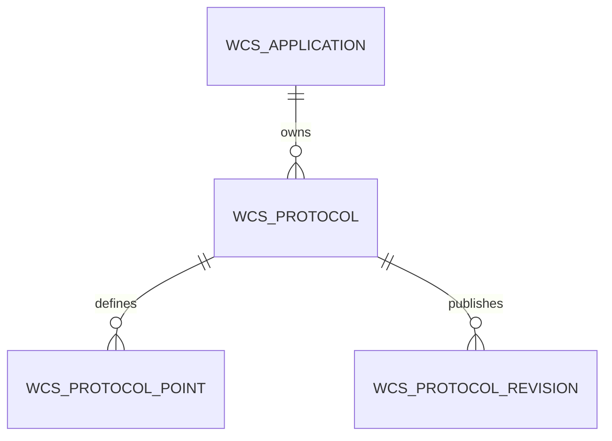

# 应用、协议与点位归属

WCS 是应用身份颁发方，应用 `id` 即开放接口的 `app_id`。管理员先注册应用取得身份和密钥，再维护应用所属协议。一个应用可有多份协议、草稿及历史版本，但运行时固定选择一份已发布协议版本。

## 操作流程

1. 应用管理 → 新建应用：平台生成 AppID，进入该应用协议页。未完成协议配置时可保存身份信息，连接监控显示待配置，不能连接或派发任务。
2. 新建协议时必须指定所属应用。也可以将其他应用协议或待归属历史模板复制到本应用；复制包括点位和故障码，生成独立草稿。
3. 在协议下维护点位，完成类型、字段集合、约束和驱动定义校验后发布。
4. 在应用配置中选择本应用的协议及固定发布版本。发布本身不会切换在用配置，也不会自动建立授权。
5. 上下游应用继续通过授权绑定确定访问关系，逐项匹配业务点位、类型及约束；连接仍校验版本、适配器、设备状态与端点配置。

协议所属应用不可直接转移，点位不可移动到其他协议；需要复用时复制为独立草稿。应用的设备报文仍由应用适配器处理，协议类型继续使用 TCP、HTTP、OPC UA 等通用传输分类。

## 数据约束与兼容

- `wcs_protocol.app_id` 指向所属应用；外键同时包含 `tenant_id`，阻止跨租户归属。
- 应用启用协议的复合外键为 `(protocol_id, id, tenant_id) → protocol(id, app_id, tenant_id)`，数据库直接拒绝跨应用选择。
- 应用固定版本与协议、租户必须一致。点位和发布版本均通过复合外键归属于同一协议及租户。
- 应用先注册时 `protocol_id` 可空，`configuration_state=awaiting_contract`；完整发布版本经过原有配置切换门禁后才转为 active。
- 旧版独占协议保持 ID、点位、发布快照、指纹、配置代次、凭据及业务时间不变。共享协议按应用拆分，复制原生映射、发布快照和故障码，仅同步必要的固定引用与已验证授权指纹，不增加权限。
- 无明确应用引用的旧配置保留在原表，并显式标记 `legacy_template=true`；不属于应用协议列表，不可直接选择或修改。`/protocol/templates` 提供只读目录，复制到应用后才成为可用协议。保留旧表和快照有助于历史追溯。
- 对外 AppID、AppKey、AppSecret、任务 payload、采集模型、导航只读边界、WebSocket、Webhook 和授权匹配语义不变。

以上历史模板保留规则属于升级兼容策略。当前 Docker 环境在升级验收后，已按用户追加指令清理全部无归属历史模板及其点位、发布版本和协议迁移记录；现存协议全部归属六个保留应用。此次为当前库的一次性维护，未更改历史 Flyway 迁移。见 [清理与验证记录](operations/2026-11-12-history-protocol-cleanup.md)。

## 管理接口变化

| 接口 | 约束 |
|---|---|
| `POST /application/create` | 不携带协议引用；平台先生成应用身份 |
| `POST /protocol/create` | 必填 `app_id`，只能指定当前租户有效应用 |
| `POST /protocol/clone` | `{id, app_id}`；复制到目标应用，省略目标时沿用原所属应用 |
| `POST /protocol/all` | 当前租户有效应用所属协议 |
| `POST /protocol/templates` | 当前租户未归属历史模板，只读 |
| `POST /protocol/list` | 支持 `searchObjects` 中 `app_id` 精确筛选 |
| `POST /application/update` | 仅可激活本应用协议及其发布版本，原有空闲和授权门禁继续生效 |

## 验证

归属约束、跨应用拒绝、先注册再激活、共享协议拆分及历史引用保留由新增测试覆盖。现有授权、任务执行、任务链、采集和状态设置测试按新的注册顺序准备独立应用协议，保留业务断言。后端全套 376 项测试中 366 项通过、10 项依赖外部环境而跳过，前端类型检查与生产构建通过。

当前数据库副本 V24 → V25 的 PostgreSQL 17 演练通过 18 项检查；隔离 Docker 通过 17 项接口检查，包含 AppID 注册、跨应用引用拒绝、独立协议授权匹配及 HTTP → OPC UA 仿真任务完成。正式部署、持续采样、保留数据和界面验收边界见 [部署记录](deployments/2026-11-12-application-protocols.md)。
