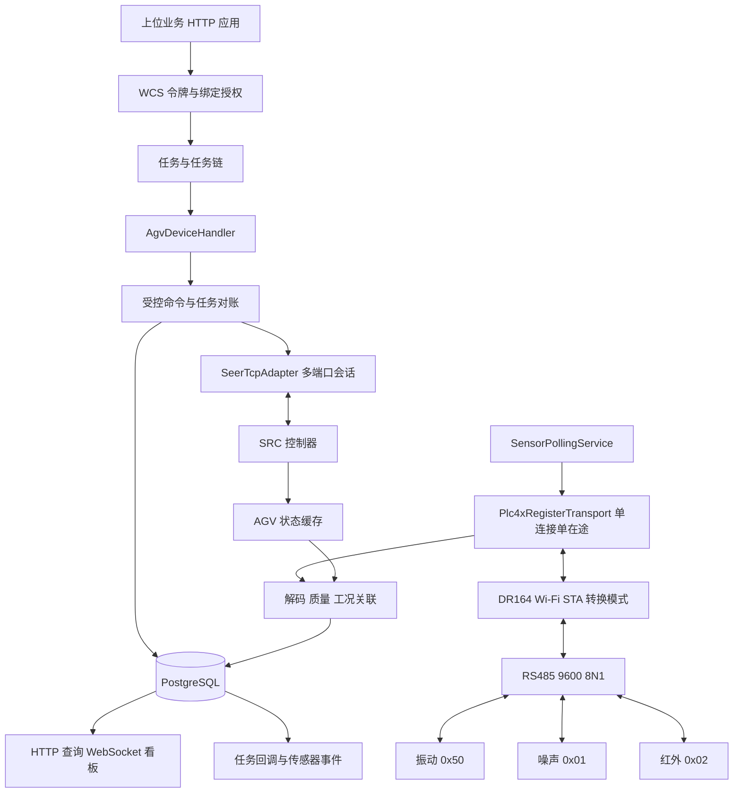
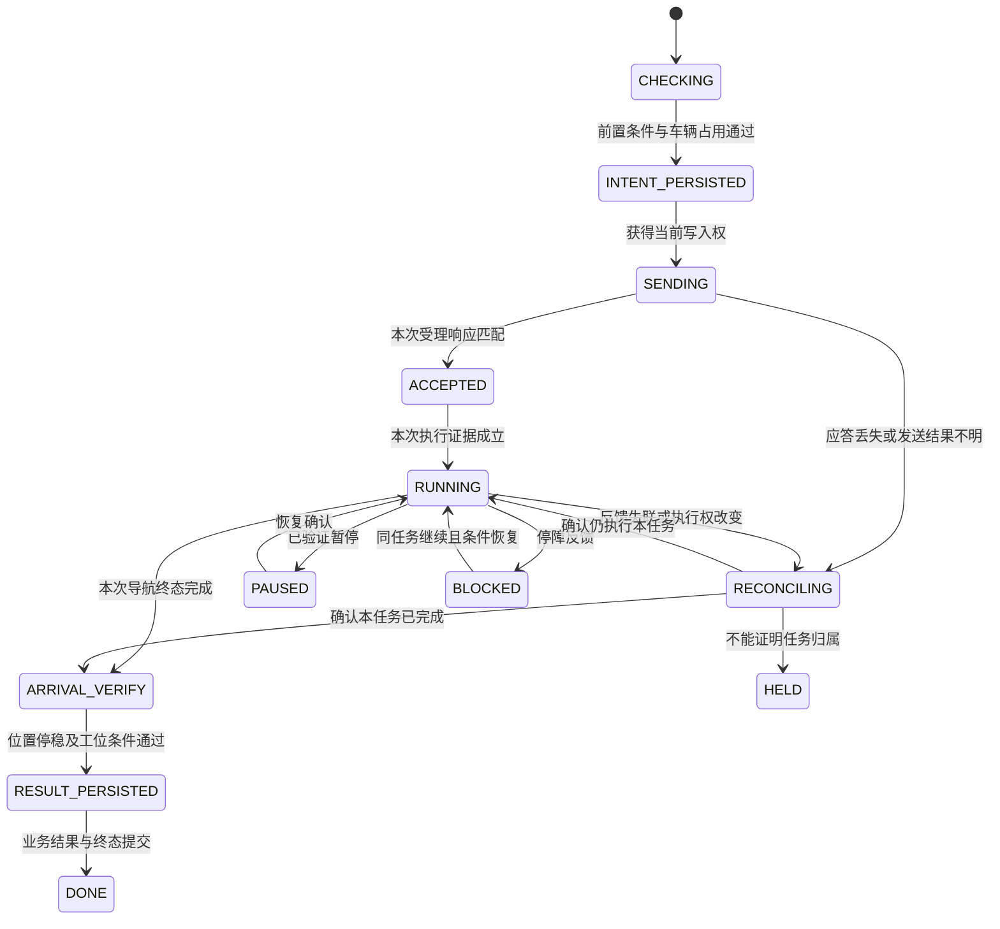

# WCS 接入仙工 AGV 运动与三传感器连续监测方案

日期：2026-11-12，Asia/Tokyo。状态：待实施的技术方案。

首期用途已确认：**监测 AGV 自身，持续采集振动、噪声和红外温度，并预留到站采集能力。** WCS 负责业务调度、数据采集、存储和展示；SRC 控制器负责导航执行与本车安全控制。沿用当前 Java 25 / Spring Boot 4 / PostgreSQL / Vue 工程，在同一 WCS 后端增加仙工驱动和采集模块。

建议先以单车、单个 WCS 执行实例落地。运动通过仙工 TCP API 直连 SRC；三传感器通过一台 DR164 接入，WCS 主动轮询。两个通道各自维护连接、时间和质量，再按同一车辆关联。采集链路故障默认产生监测告警；业务若要据此暂停车辆，须另行定义、验证受控暂停规则。

## 1 当前源码与可复用能力

以下事实取自本机源码，不能理解为本次已经对运行容器或实车完成验收。根项目索引仍写 WCS 待 clone，本机实际已有完整独立仓 `cayley_project/cayley_wcs`。

| 现有模块 | 当前能力 | 本次对接方式 |
| --- | --- | --- |
| [ProtocolAdapterFactory](../../backend/src/main/java/com/cayleywcs/adapter/ProtocolAdapterFactory.java) | 按协议类型装配 Provider | 新增 `seer_tcp` Provider；保留已有适配器 |
| [TcpAdapter](../../backend/src/main/java/com/cayleywcs/adapter/tcp/TcpAdapter.java) | 四字节长度头加 `PointMessage` JSON | 与仙工帧不同，新增专用 codec 和会话 |
| [Plc4xAdapter](../../backend/src/main/java/com/cayleywcs/adapter/plc4x/Plc4xAdapter.java) | PLC4X 读写、连接内串行、Modbus 字节序处理 | 复用 PLC4X 底层连接，增加面向读块的采集传输层 |
| [Plc4xConnectionStrings](../../backend/src/main/java/com/cayleywcs/adapter/plc4x/Plc4xConnectionStrings.java) | 从连接参数生成固定站号连接串 | 传感器需要单连接逐请求切换 Unit ID，另封装读块接口 |
| [ConnectionManager](../../backend/src/main/java/com/cayleywcs/connection/ConnectionManager.java) | 连接意图、重连、轮询、状态快照 | 管理 AGV 逻辑连接；仙工多端口会话由专用适配器持有 |
| [TaskEngine](../../backend/src/main/java/com/cayleywcs/task/TaskEngine.java) / [DeviceHandler](../../backend/src/main/java/com/cayleywcs/device/DeviceHandler.java) | 每设备单飞、优先级队列、按设备驱动推进 | 新增 `AgvDeviceHandler`，保持现有调度入口 |
| [TaskExecutionService](../../backend/src/main/java/com/cayleywcs/task/TaskExecutionService.java) | 来源、协议版本、授权、PLC 数字任务号、结果持久化 | 保留通用校验，增加 AGV 的占用、任务关联、空闲和结果策略 |
| [DevicePointTemplates](../../backend/src/main/java/com/cayleywcs/protocol/contract/DevicePointTemplates.java) | 实现 stacker / conveyor / lift / auto_door | `agv` 目前只是字典预留，须正式增加 AGV 模板与验证 |
| [DeviceExecutionCoordinator](../../backend/src/main/java/com/cayleywcs/connection/DeviceExecutionCoordinator.java) | 进程内设备锁 | 继续用于同车写入、配置、取消互斥；它不是跨实例租约 |
| [TaskOrchestrator](../../backend/src/main/java/com/cayleywcs/task/orchestrate/TaskOrchestrator.java) | 顺序任务链、候选设备物化 | 复用车辆与输送线等设备的业务串联；车辆内部导航由 AGV 驱动负责 |
| [ApplicationTokenFilter](../../backend/src/main/java/com/cayleywcs/openapi/ApplicationTokenFilter.java) / [OpenAccessGuard](../../backend/src/main/java/com/cayleywcs/openapi/OpenAccessGuard.java) | POST JSON 公共封装、应用令牌、设备绑定授权 | 运动和新增采集查询均沿用当前认证与固定归属 |
| [MonitorPusher](../../backend/src/main/java/com/cayleywcs/monitor/MonitorPusher.java) / [WebhookScanner](../../backend/src/main/java/com/cayleywcs/webhook/WebhookScanner.java) | 实时看板、任务与报警回调 | 增加 AGV/采集摘要；任务终态沿用现有回调，传感器事件增加明确事件源 |

首期直接复用任务表、任务链、协议发布快照、绑定授权、审计、看板连接和回调投递设施。高频波形、车载离线补录、车队交通管制均不在此基线内。

## 2 总体连接与身份模型



**一辆车对应一个运动设备应用。** `wcs_application.device_type=agv`、`protocol_type=seer_tcp`，上位应用绑定到该车。车辆基本身份、权限和任务仍使用该应用 ID。

**采集网关是该车的子资源。** 新增 `wcs_sensor_gateway.agv_app_id`，网关下挂三个 `sensor_device`。网关不创建三个独立设备应用，也不进入 `TaskEngine` 的业务任务队列。这样可以保持一条总线一个连接，同时避免三台传感器竞争派工与连接槽。

传感器会话由 `telemetry.gateway` 独立管理，复用现有连接治理的意图、退避和诊断规范；不把它直接塞进当前按应用 ID 索引的同一个 `ManagedConnection`。连接页通过新增只读汇总展示运动与采集两种连接。网关拥有单独的启停意图，车辆业务暂停不停止连续监测。

WCS 到 SRC 与到 DR164 都是客户端主动建连。现场 AP 提供无线接入，WCS 可接有线网络。SRC 和 DR164 作为两个不同端点管理；实际地址、现场监听配置、无线密钥与凭据放在受控运行配置，通过 `network_ref` 引用。

## 3 运动协议与能力分期

### 3.1 通道和成帧

仙工普通 v1 使用 `16 字节二进制头 + UTF-8 数据区`；头中包括 `0x5A`、`0x01`、序号、数据区字节数和 API。按大端序解析；应答按完整帧截止时间组装，校验连接代次、序号、响应 API 和错误码，处理分片、粘包、超长及迟到帧。

| 会话 | 使用范围 | 首期安排 |
| --- | --- | --- |
| 状态查询 | 地图、定位、速度、导航状态、阻挡、急停、告警、电池、顶升反馈 | 常驻；每次请求完整结束后发送下一笔 |
| 导航 | 3051 站点导航；经本车确认的 3001/3002/3003 | 动作按需发送，单连接最多一个在途请求 |
| 控制 | 切图、重定位、速度移动 | 维护能力，首期业务不自动启用 |
| 配置与外设 | 控制权、顶升、载货模型 | 获得本车能力合同后按需启用 |

端口分类依据 [仙工官方 Java 客户端](https://github.com/seer-robotics/SeerSdk4j/blob/master/src/main/java/com/seer/sdk/rbk/RbkClient.java)，UTF-8 长度依据[官方编码器](https://github.com/seer-robotics/SeerSdk4j/blob/master/src/main/java/com/seer/sdk/rbk/RbkEncoder.java)。这些公开实现用于封包与路由，动作字段仍以交付固件合同为准。

`SeerTcpAdapter.readAll()` 按 API 批量刷新一次响应，再映射到多个逻辑字段，避免每个字段重复查询同一个 API。帧和各 API 反馈分别记录 `receivedAt/connectionEpoch/quality`。地图、站点等低频信息缓存，原始激光诊断按需读取。

按能力档案区分派单必需反馈与可选反馈。核心反馈缺失或陈旧时停止新派单并进入对账；可选电池、机构等接口只有确认支持后才启用，其异常独立报告。当前通用快照是整批校验和整体 good/bad，新增 AGV 状态模型需保留各 API 的质量，不能为满足快照校验而给缺失字段补默认值。

业务动作通过新增可选的 `CommandCapableAdapter` 和受控命令入口执行，一次提交完整命令；不能把任务各字段逐一写成多条导航命令。命令入口须经过设备互斥、绑定和固定版本检查、发送意图持久化，禁止控制器直接取得 socket 绕过这些门禁。

### 3.2 首期开放与后续能力

| 能力 | 接入设计 | 启用条件 |
| --- | --- | --- |
| 地图与站点同步 | 1300 → 1301 → 1300，校验前后地图身份，再维护业务工位映射 | 已有本项目只读证据，仍需核对交付固件和当前图 |
| 站点导航 | 3051，内部转换为 `{"id":"站点ID"}` | 单车控制权、目标站点动作与路线完成确认 |
| 执行与到站 | 1020 + 1004 + 1005，并结合地图与任务归属 | 当前任务关联规则和停稳验收参数已冻结 |
| 暂停、恢复、取消 | 3001/3002/3003，命令和执行反馈分开保存 | 本车实际效果与失联行为验收后启用 |
| 载货与充电 | 1027、1007 等反馈；区分到桩、对接和充电 | 按车确认字段；充电业务成功条件单独定义 |
| 顶升取放、指定高度 | 独立动作能力及结果判定 | 6070～6073 本车定义、单位、基准、行程、限位与载货检测确认后启用 |
| 坐标导航与速度移动 | 能力接口预留 | 3050/2010 的坐标系、路线约束、看门狗与停止行为验收后启用 |

首期运动任务只提供已批准站点的导航。`AP0` 或 `CP18` 的类型名称不能证明点位只执行移动：点位可能带识别、顶升、对桩或充电动作。工位档案要明确 `pure_navigation` 或已批准的复合动作，避免导航已执行顶升后又独立发送一次顶升。

站点关系保存为“车辆应用 + 已发布地图版本 + 业务工位 + 原生站点 ID”。地图变更后重新同步并校验。若当前固件不提供可信地图摘要，WCS 自算的站点列表摘要只能识别站点差异，不能证明路线和动作没有变化；地图发布须经维护流程冻结版本。

### 3.3 状态查询节奏

初始目标为：核心导航、定位、速度在有任务时各约 1 秒刷新；阻挡、急停和告警约 1～2 秒；电池和机构约 2～5 秒，地图在连接恢复、发布或派单检查时核对。这些是调度目标，须按实际串行往返和固件频率限制调整。

由一个状态查询调度器执行到期 API，优先保证在飞任务必需反馈；不由每个监控组件各自查询。超过请求预算跳过旧轮次，API 数据超过自身新鲜度阈值即标未知。WCS 界面一秒刷新不构成硬实时反馈保证。

## 4 AGV 任务状态与恢复

### 4.1 状态机

沿用现有公共任务状态，AGV 的细分阶段写入 `wcs_agv_execution.phase` 和 `handshake_step`：



`CHECKING` 对应 `pending`；发送意图提交后为 `dispatched`；运行、暂停、停障和对账一般保持 `executing/dispatched`。`HELD` 是占用中的待核对阶段，记录原因，不伪装成已完成或空闲。完成后为 `completed`；已经确认的设备任务失败才落 `failed`。失败、取消后的车辆和工位占用须经物理结果确认才释放。

AGV 执行表分别保存最近有效反馈时间、最近实际进展时间和阶段起点。任务行每轮保存产生的 `last_update_time` 不能代替这些时钟；恢复策略按实际反馈和阶段预算判断，停障等待与通信失联分别计时。

发送前检查：机器人身份与版本、地图版本、目标站点和动作、自动模式、控制权、定位可信度、急停与相关故障、底盘和机构状态、载荷条件、电量及车辆/工位占用。阈值按车与路线验收配置。

### 4.2 幂等、任务关联与未知结果

上位重试继续复用现有 `appId + taskNo` 与请求指纹；同编号不同正文拒绝。新增命令记录按 `taskId + attempt + commandNo` 唯一，发送前提交完整意图与参数摘要。

协议序号只关联一个 TCP 请求应答，不能充当业务任务 ID。优先使用经厂家确认能回显并查询的原生任务 ID。若固件只支持 `{"id":"AP0"}`，必须采用单一动作发送者、发送前基线与本次运行跃迁等证据；**仅有相同目标和完成状态不能区分前一次与本次导航。**

若在应答丢失、WCS 重启或同站重复导航后无法建立唯一关联，保持占用并进入 `HELD`，由现场核对或明确的人工接管完成处理。不得声称通过数据库命令记录就实现了实车动作恰好一次，也不得编造车端不存在的 `status_TaskNum`。

发送前后存在无法由数据库与机器人原子提交消除的窗口。因此崩溃恢复从查询开始：核对身份、地图、控制权、1020 以及定位和速度；不能证明未执行就不自动重发。数据库写失败时停止新动作发送；已有车端任务继续按已确认的控制器策略执行。

### 4.3 完成判据

站点导航完成至少同时满足：

1. 当前身份、地图、任务归属和目标都正确，各反馈新鲜且来自有效连接代次。
2. 1020 显示本次导航完成；保留原始状态与标准化状态，使用本车确认的枚举。
3. 1004 当前站点及必要位置/朝向误差符合该工位条件。
4. 1005 底盘持续停稳；建议初始采用至少两个相邻有效停稳样本，速度容差与间隔须现场确认。
5. 工位若包含对接、载荷转移或充电，继续核对对应的专属条件。
6. 先将最终证据、业务结果和任务终态提交数据库，再由现有投递链路通知上位并释放可释放的资源。

停障停车、失败后距离清零、原地历史完成状态均不能单独满足上述条件。首期传感器质量独立于导航结果：导航完成时温度预热中，可同时报告导航成功与温度 `WARMING_UP`。

### 4.4 必须适配的现有通用逻辑

| 当前实现 | AGV 需要的处理 |
| --- | --- |
| `AbstractDeviceHandler.advanceGuarded()` 非零故障码直接失败 | 提供设备专属故障分类，结合导航状态判断停障、暂停与终态失败；保留原始告警列表 |
| `TaskExecutionService` 分配 PLC 数字任务号、判断 `status_Task=0` 空闲 | 通过新增 `DeviceExecutionPolicy` 保留 PLC 默认实现，AGV 使用独立车辆占用、原生关联与多执行器空闲判据 |
| `TaskExecutionService.captureResult()` 从点位快照提取结果 | AGV 策略只接受已关联的终态证据；独立传感器数据放在遥测模型，不要求采集失败使导航失败 |
| `cleanupUnstarted()`、运维空闲与故障复位以 PLC 点位为基础 | AGV 采用专属策略，不向站点字符串或导航字段写零清理，也不把清报警当作车辆复位 |
| `TaskRecoveryScheduler` 超时可直接失败并按策略重试 | 对 AGV 路由到专属恢复策略；失联先对账、保留占用，首期禁止动作自动重派 |
| `TaskServiceImpl.cancel()` 拒绝执行中任务 | 保留普通取消语义，新增“执行中导航受控取消”命令，等待车端终态和停稳后提交 |
| 任务链取消只取消待执行段，在飞段继续 | 界面明确“停止后续段”与“请求取消当前导航”；后者走上述受控动作链路 |
| `idle_first` 只看连接、工作模式和积压 | AGV 候选还需过滤未决占用、任务关联、控制权、定位、电量和载荷能力 |

`DeviceExecutionPolicy` 还需接入 `ApplicationConfigurationService` 的配置切换门禁。`TaskEngine` 和普通 PLC 驱动的默认行为继续使用现有实现。AGV 型故障码应至少使用可容纳 52202 等数值的整数类型，不能套用有符号 INT16 的 PLC 故障码约定。

### 4.5 执行权与部署

首期一个 WCS 执行实例持有该车的动作权，RoboShop/人工与 WCS 的切换执行维护交接。失去控制权后停止发送，不自动抢回；重新获得控制权前先对账。

新增 `wcs_agv_reservation` 以车辆应用 ID 为唯一占用键，即使原任务已失败但物理结果未明，也不允许新任务覆盖。`DeviceExecutionCoordinator` 仍承担进程内互斥。

当前源码没有通用跨实例采集领导者机制。未来主备部署需要增加所有者租约、代次校验、接管对账与旧实例隔离；SRC 不支持 fencing token 时，还要有可证明的旧实例网络/进程隔离措施。仅有数据库租约或 DR164 最大连接数 1，不能保证网络分区下不会双写。

## 5 三传感器采集通道

### 5.1 硬件和读块

遵循[三传感器无线采集设计与编码计划](../../../cayley_seer_agv/AGV_三传感器无线采集设计与编码计划_20261111.pdf)第 1、4、7～10 页：一车一台 USR-DR164，Wi-Fi STA，Modbus TCP 转 RTU；三台传感器共用 RS485，统一 `9600 / 8N1`。调试阶段先逐台配置，再合并总线。采用受保护辅助电源或匹配电池与充电极值的隔离稳压 24 V 电源；数据主干短支线，终端、屏蔽、共模和防护按整车电气条件验证。

| 顺序 | 传感器与 Unit ID | 原始零基寄存器偏移 | 解析和输出 |
| --- | --- | --- | --- |
| 1 | WTVB01-485，`0x50` / 80 | `0x003A`，3 字 | X/Y/Z 振动速度，u16 / 100，mm/s |
| 2 | WTVB01-485，`0x50` / 80 | `0x0040`，7 字 | 芯温 raw / 100；三轴位移 u16，μm；三轴频率 u16 / 10，Hz |
| 3 | RS-ZS-N01-BK，`0x01` | `0x0000`，1 字 | 瞬时噪声 u16 / 10，dB |
| 4 | RS-WD-HW-N01-2，`0x02` | `0x0000` 或 `0x0001`，1 字 | 表面温度 u16 / 10，℃；按实际版本固定寄存器与量程 |

每轮四笔功能码 03，核心十二个数值。0x0040 连读七字需实物确认；不支持时拆块并调整周期。振动负芯温编码未确认时保留原始字并标未知。可选三轴加速度首期默认关闭；不跨读手册未定义的 0x003D～0x003F。

### 5.2 传输实现选择

优先新增 `Plc4xRegisterTransport.read(unitId, zeroBasedStart, count, deadline)`，直接复用当前锁定版本 PLC4X 0.13.1 的 Modbus 底层连接。该版本支持 tag 级 Unit ID 覆盖；应在新传输层集中生成地址、转换零基偏移，并验证生成的实际报文。[PLC4X 0.13.1 官方说明](https://plc4x.apache.org/plc4x/0.13.1/users/protocols/modbus.html)

当前项目 helper 使用 `unit-identifier`，官方版本文档列 `default-unit-identifier`；接入时核对实际依赖行为和配置名，不能把参数已经生效作为前提。当前通用 `Plc4xAdapter` 的点位地址解析和整批读取流程也需要与新增传输层分开处理，不能仅把带 Unit ID 的字符串填入现有页面就视为完成。

第一道软件门槛是捕获实际网络帧，确认同一 socket 上 Unit ID 依次为 80、80、1、2；偏移分别为 0x003A、0x0040、0x0000 和已确认红外寄存器；在途不超过一笔，没有底层自动重试、后台探测或批量拆分破坏总线节奏。

若现有 PLC4X 不能满足绝对截止时间、取消、后台行为控制或会话重建要求，再在同一 `RegisterTransport` 接口下实现精简的 MBAP 客户端。首期无需为此升级全仓库 PLC4X，也无需额外引入网关服务。手写客户端仍要验证 TID、Unit ID、功能码、字节数、连接代次及缓冲上限。

业务采集只读。DR164 使用转换模式时 WCS 不添加 RTU CRC；网关负责串口 CRC。透明 RTU over TCP 是整条连接的兼容回退模式，不能与 Modbus TCP 帧混发。

### 5.3 节奏与故障恢复

| 参数 | 初始设计值 | 处理 |
| --- | --- | --- |
| 轮询周期 | 正常两秒一轮 | 以现场 P95 验收；慢响应时显示实际降速 |
| 总线请求间隔 | 上一笔结束后至少 250 ms | 跨从站统一执行 |
| 完整请求截止时间 | 一秒，可配置 | 从发送到完整应答，用单调时钟计算 |
| 每网关在途数 | 一 | 每车一个会话；不同车辆可并行 |
| 陈旧阈值 | 六秒 | 每指标单独判断，不用网关在线代替指标新鲜 |
| 从站降级 | 连续三次失败后低频探测，初始十秒一次 | 为健康从站保留采集机会 |
| 超时静默窗口 | 初始两秒 | 关闭污染会话，按实测残留延迟和网关行为修订 |
| 重连退避 | 1、2、4、8、10 秒上限并加抖动 | 不补发过期周期 |

RTU 应答没有起始寄存器地址和事务号，DR164 可能将迟到串口响应绑定给后一个 TCP 请求。换 TCP 连接、核对 TID 仍不足以证明总线已经排空。必须用实际网关配合可延迟应答的串口从站模拟器验证；无法证明归属正确时不通过生产门槛，改用具备明确事务隔离语义的实现或增加车载采集节点。

网络收包、采集解码、数据库写入使用有界队列和独立执行器；慢数据库不阻塞运动控制或网络解析。可初始每车缓存六十轮，积压时丢弃旧待写周期并记录缺测与丢弃计数。该内存缓冲不提供断电持久性。

### 5.4 质量和时间

每个指标保存 `value/rawValue/unit/quality/reason/sentAt/receivedAt/profileVersion`。无可信设备采样时间时 `sourceSampleAt=null`；同轮四块先后取得，不能标为同步采样。

质量至少包括 `GOOD`、`WARMING_UP`、`WARMUP_UNKNOWN`、`STALE`、`TIMEOUT`、`PROTOCOL_ERROR`、`OUT_OF_RANGE`、`UNKNOWN`。通信状态独立使用在线、降级或离线；一个传感器失联不能使另外两个的有效读数整体失效。

红外从可信连续供电起预热至少四十分钟。短暂 Wi-Fi 断连本身不重置预热；重连和 WCS 重启也不能证明传感器一直有电。缺少可信供电证据时进入 `WARMUP_UNKNOWN`，从重新确认供电时保守计时。预热读数可以展示，不能参与有效温度超限判断。

最新状态与最后有效值分别保存。失败不写零，不用旧值继续累计超限持续时间。只有新鲜 `GOOD` 数据参加相应工况的规则；断档打断连续条件，规则使用阈值、持续时间和回差。振动速度不擅自标 RMS，噪声先使用 dB，芯温与红外表面温度分开命名。

## 6 运动上下文与到站采集预留

连续采集不依赖车辆是否存在 WMS 任务。每个读块关联采集时附近的 AGV 状态：地图版本、位置/朝向、站点、速度、当前业务任务、导航阶段、顶升/载货反馈及工况。

关联时保留 `contextCapturedAt/contextAgeMs/contextQuality` 和运动连接代次。优先使用不晚于该读块接收时刻的最近有效状态；缺失或过旧时将工况标未知，仍可保留传感器原始数据。禁止读取“现在的位置”再无时间说明地补到过去的采样上。

建议保留短时 AGV 状态环形缓冲，按每块接收时间关联。工况分为静止、行驶、转弯、顶升、充电和未知；可同时带多个状态标志。AGV 自身的驱动、风扇、安装位置和载货条件影响振动与噪声，阈值按工况和测点版本维护。

到站采集后续以 `inspection_profile` 接入：本次导航完成 → 持续停稳 → 工况稳定等待 → 在指定窗口内等待新的有效样本 → 保存采集报告 → 任务链继续。只复用唯一连续采集器，不再建立第二个 Modbus 客户端。窗口按传感器物理响应与现场需要配置，不能用到站前缓存值代替。

首期只预留 `inspection_profile_id/window_id` 等关联点和查询扩展，不启用采集窗口阻塞任务。后续增加 `INSPECT` 任务动作时，必须将采样条件、缺测策略和结果字段作为新协议版本发布。

## 7 数据存储与事件

### 7.1 拟新增表

所有资源带固定归属，关联应用、网关和设备时校验归属一致；归属不能由上位业务正文指定。新增实体、Mapper、Service interface / impl 沿用项目规范。

| 表或表组 | 核心内容 |
| --- | --- |
| `wcs_agv_profile` | 运动应用 ID、控制器/固件、能力合同版本、配置引用、允许的动作 |
| `wcs_agv_map_revision` / `wcs_agv_station_binding` | 已发布地图版本、摘要来源、站点、业务工位和动作分类 |
| `wcs_agv_execution` | 任务 ID、尝试号、阶段、关联模式、原生任务 ID（可空）、发送前基线、终态证据 |
| `wcs_agv_reservation` | 车辆唯一占用、所属任务、保留原因；失败后未决占用继续存在 |
| `wcs_device_command` | 命令唯一编号、任务/尝试、API、参数摘要与档案版本、发送意图、受理和对账状态 |
| `wcs_sensor_gateway` | 车辆应用、网络引用、串口配置、转换模式、配置版本与启停意图 |
| `wcs_sensor_device` | 网关、Unit ID、型号、固件、解码档案、实际量程、测量目标、安装位置/轴向、供电记录来源 |
| `wcs_telemetry_cycle` | 一轮的分块读数、raw 字、每块时间、质量、车辆上下文和缺测信息 |
| `wcs_telemetry_latest` | 每设备每指标的最新状态与最后有效值，带各自时间和档案版本 |
| `wcs_sensor_rule` / `wcs_sensor_event` | 工况规则、持续/回差、追加式产生/恢复事件、关联样本与操作记录 |

当前源码迁移到 V21；正式编码按当时最新版本顺延迁移，禁止修改已应用的历史迁移。运动协议种子、运动运行表、采集表可以分别迁移，便于阶段部署。

### 7.2 幂等、索引和容量

- 读块采样使用 `gateway_id + collector_session + cycle_seq + block_seq` 标识；指标在读块内保持唯一。周期历史若按一行 JSON 存储，唯一键用 `gateway_id + collector_session + cycle_seq`。
- 设备档案对同网关的启用 Unit ID 唯一；最新值对 `sensor_id + metric` 唯一，带档案版本用于更换设备时的比较和回放。
- 历史查询使用固定归属、车辆/传感器、时间和 ID 的组合索引与游标分页，不将全部历史装入内存。最新值更新检查会话代次和序号，旧回调不能覆盖新数据。
- 正常两秒一轮约 43,200 轮/车/天、518,400 个标量；约 1 KB/轮时为 43.2 MB/天、30 天约 1.3 GB/车，尚未计索引、WAL、备份和额外诊断。实际 JSON 包含上下文后可能更大，落库后重新测量。
- 初始原始周期保留三十天，分钟聚合按业务需要配置。先测实际规模，再决定 PostgreSQL 时间分区；首期不预设引入时序数据库。

### 7.3 报警和外发

传感器业务告警映射到现有 `wcs_alarm` 展示，挂所属 AGV 应用；传感器通信与规则使用独立、明确登记的码空间，避免与运动连接恢复时清理的通信报警混淆。传感器异常不写进导航的 `status_ErrorCode`。

温度、振动、噪声阈值先作为监测提示。三类传感器不承担安全急停，不能替代安全激光、急停和车端安全控制。若需要自动业务暂停，应单独定义“有效数据触发—受控暂停—反馈确认—人工或受控恢复”的能力并验收。

任务终态继续复用当前 Webhook。原始连续数值通过快照/历史查询和 WebSocket 提供；不每两秒生成一组 Webhook。

需要保证每次传感器报警产生和恢复都可追溯时，将状态变化追加到 `wcs_sensor_event`，再为现有投递器增加传感器事件源及事件白名单，例如 `sensor.alarm.raised`、`sensor.alarm.cleared`。以不可变事件 ID 去重，支持消费重放；不能假设扫描可变的最新报警行就一定捕获每一次短暂变化。

## 8 业务接口与前端

### 8.1 保持当前公共合同

所有业务接口为 `POST + application/json`。上位系统仍通过 `POST /system/token` 获取令牌，`/open/**` 使用现有 `app_id/app_key/access_token/request_id/data` 封装。外层 `app_id` 是调用方，`data.appId` 是目标车辆，两者不能混淆。

继续使用 `POST /open/task/dispatch`，业务数据示意如下，数字 ID 和版本串都是占位示例：

```json
{
  "appId": 10001,
  "taskNo": "AGV-NAV-20261112-0001",
  "priority": 10,
  "wmsRef": "BUSINESS-0001",
  "payload": {
    "cmd_Action": "NAVIGATE",
    "cmd_MapRevision": "approved-map-revision",
    "cmd_TargetStation": "AP0"
  }
}
```

以上是拟发布 AGV 模板，当前接口尚不能接受该 payload。上位 HTTP 模板和下位 `seer_tcp` 模板须发布并固定同一套 AGV 业务请求/响应定义，再建立匹配授权。地图版本字段供 WCS 校验，发送给 SRC 的原生 JSON 只含已核实字段。

响应模板采用已确认的导航状态、站点、地图、位置、停稳与故障等业务字段；缺失字段按合同报未知或质量异常，不默认补零。命令、状态字段类型和动作条件交给 AGV 专属模板验证，传感器 raw→工程量换算在解码档案中完成。现有点位发布拒绝非 1 的 `scale`，不能直接填 `0.01` 期待通用驱动自动缩放。

### 8.2 拟新增入口

| 入口 | 使用者与作用 |
| --- | --- |
| `/agv/profile/*`、`/agv/station/*` | 管理端 JWT，维护车辆能力档案、地图版本与业务工位映射 |
| `/agv/control/pause`、`/agv/control/resume`、`/agv/control/cancel` | 管理端受控导航操作，携带任务关联与唯一 `controlNo`，记录受理与实际结果 |
| `/sensor/gateway/*`、`/sensor/device/*` | 管理网关、只读采集计划、设备档案与可信供电记录 |
| `/telemetry/latest`、`/telemetry/history`、`/telemetry/health` | 管理端读最新数据、游标历史和采集健康；查询只读缓存/数据库 |
| `/open/agv/telemetry/latest`、`/open/agv/telemetry/history`、`/open/agv/sensor-health` | 上位应用查询，按目标 AGV 应用走 `OpenAccessGuard` 设备绑定权限 |

表中每个具体接口均为 POST；`/*` 表示沿用项目分页、保存、启停等明确动作路由，编码时逐项定义 DTO，不能暴露任意路径透传。若后续需要上位调用导航暂停等动作，应另加 `/open/agv/control/*` 并单独定义能力授权、幂等和任务归属；首期管理操作接口不直接对外映射。

采集返回值按指标带质量和时间，示意：

```json
{
  "appId": 10001,
  "sensorId": "noise-01",
  "metric": "noise_db",
  "value": 71.3,
  "rawValue": 713,
  "unit": "dB",
  "quality": "GOOD",
  "receivedAt": "<UTC timestamp>",
  "sourceSampleAt": null,
  "profileVersion": "approved-noise-profile",
  "context": {
    "motionState": "MOVING",
    "taskNo": "AGV-NAV-20261112-0001",
    "capturedAt": "<UTC timestamp>",
    "ageMs": 300
  }
}
```

示例量值来自说明书算例，不是本次现场读数。`receivedAt` 表示服务器收到完整应答时间，不是噪声变化或传感器内部采样发生时间。

### 8.3 页面安排

在现有前端内增加车辆与工位配置、传感器档案和车辆详情，不另起 HMI 工程。

- 车辆详情：地图/站点、位置、任务阶段、停障/控制权、载货/充电、运动与采集连接分别显示。
- 连续监测：三个传感器卡片、十二个指标、单位、更新时间、质量和预热；历史曲线叠加任务与工况，缺测显示断点。
- 任务页：标准任务状态加 AGV 执行阶段、未决原因、动作受理/执行结果；暂停新派工和暂停当前导航分别命名。
- 连接页：按车辆汇总 SRC 多端口健康和 DR164 总线健康；展示实际轮询周期、超时、降级和排空状态。
- 报警页：区分运动故障、传感器通信、测量条件和业务超限；确认与恢复分开。

WebSocket 可在现有监控帧中增加有界的 `agvs/sensorGateways/telemetry` 摘要，不改旧字段含义，保留序号与时间。断线后通过 HTTP 快照恢复；首次和过期显示不能把旧数据标为实时。新增推送按既有会话权限约束过滤，并验证两种固定归属间的数据隔离。历史曲线通过分页接口取得，不能每个页面打开都新增总线轮询。

## 9 拟议代码落点

以下名称为实施落点，尚未创建业务实现：

```text
backend/src/main/java/com/cayleywcs/
  adapter/seer/
    SeerTcpAdapterProvider, SeerTcpAdapter
    SeerFrameCodec, SeerPortSession, SeerApiProfile
  device/agv/
    AgvDeviceHandler, AgvExecutionPolicy, AgvRecoveryPolicy
    AgvCommandService, AgvStatusService, AgvStationService
    impl/, entity/, mapper/
  telemetry/
    gateway/    GatewayRegistry, GatewaySession, Plc4xRegisterTransport
    polling/    SensorPollingService, ReadPlan
    profile/    WitVibrationProfile, RenkeNoiseProfile, RenkeInfraredProfile
    quality/    MeasurementQualityService, WarmupService
    storage/    TelemetryService, impl/, entity/, mapper/
    alarm/      SensorRuleService, SensorAlarmEvaluator
    api/        TelemetryController, OpenAgvTelemetryController
frontend/src/views/
  AgvView.vue, AgvDetailView.vue, SensorView.vue
```

共享改动集中在协议类型与 `agv` 模板注册、JSON 原生类型映射、可选完整命令能力、执行/恢复策略扩展、受控取消、监控摘要与事件源。增量修改 `PointTypeRegistry`、合同验证、前端点位类型选项和协议字典时，保持其他协议的现行规则。

运动与采集分别使用有界执行器和资源预算。不能在 `DeviceExecutionCoordinator` 的车辆锁内等待整轮传感器采集、长时间导航完成或数据库批量写入。PLC 现有读写路径保留默认策略，并运行最近相关回归防止行为变化。

## 10 实施顺序与交付边界

| 阶段 | 工作与交付 | 通过条件 |
| --- | --- | --- |
| M0 合同冻结 | 车型/固件、唯一动作发送者、当前地图与站点动作、三传感器档案、网关固件与网络；确认代码策略扩展点 | 明确支持/待确认能力和黄金报文，现场端点只进运行配置 |
| M1 两条只读通道 | 仙工状态会话、DR164 单连接四读块、单在途与采集质量 | 与已核实原包/厂家工具对齐，站号与寄存器正确 |
| M2 导航闭环 | AGV 发布模板、设备占用、发送意图、站点导航、完成保存与上位回调 | 正常导航和受理未知/重启/停障测试通过，不重发未知动作 |
| M3 连续监测 | 十二个指标、档案换算、预热/陈旧、上下文、最新/历史 API、存储保护 | 通信失败和测量无效可见，旧值不变新值，慢存储不影响运动 |
| M4 运维与联动 | 页面、告警事件、受控暂停/恢复/取消、配置和执行权交接 | 任务归属、绑定权限、故障恢复和取消结果可核对 |
| M5 现场验收 | 实际路线上空载/载货、顶升/充电工况、无线覆盖、断网、24 小时稳定运行 | 达到下表指标，保存固件与配置版本和异常原包 |

工作量按单车、单实例、现有框架复用估计约 15～22 个工程工作日，含正常前后端开发与联调；另安排 24 小时稳定运行观察。此为排期估算，排除采购、厂家资料等待、网络整改和未确认顶升动作开发。到站巡检与多车交通调度单独排后续阶段。

## 11 验证与现场验收

| 类别 | 必测情况 | 合格标准 |
| --- | --- | --- |
| 仙工帧 | Unicode 长度、逐字节到达、粘包、错误 API/序号、损坏与超长帧、跨代次迟到响应 | 合法完整帧才进入状态，错误帧不绑定到新请求 |
| 运动幂等 | 同任务重复下发、同号改参数、发送前后崩溃、受理应答丢失、同站重复导航 | 不重复发送未知动作；无法关联时占用和待核对可见 |
| 导航结果 | 运行中停车、暂停、停障、历史完成、失败距离归零、真实到站、地图改变 | 只按本次关联、地图、目标、位置和停稳的联合证据完成 |
| 控制与恢复 | 控制权被接管、断网仍在运行、WCS 重启、执行中取消应答丢失、配置切换 | 停发新动作、先对账、无占用提前释放；取消不冒充安全急停 |
| 回归 | 普通 PLC 任务、任务链、版本和授权、取消、Webhook | 原设备默认行为不改变，新增能力有边界测试 |
| Modbus | 同 socket 多 Unit ID、零基偏移、UINT 大值、长度/TID/异常码、后台自动读写 | 一条总线单在途，严格归属；60000 正确解为 600 mm/s |
| 网关真实行为 | 串口超时后迟到帧、同站同长度不同寄存器、坏 CRC、网关重启 | 无误归属；无证据的排空上界不能作为通过项 |
| 测量质量 | 四十分钟边界、供电未知、网络短断、WCS 重启、六秒陈旧、噪声不变 | 预热不报有效超温，重复读数不被当作失联，失败不写零 |
| 工况与存储 | 上下文过期、任务切换、慢/断数据库、有界缓存满、重复保存 | 上下文年龄可见、幂等成立、丢弃和缺测可见，运动线程不被拖住 |
| 鉴权 | 两个固定归属、未绑定上位、只读查询、维护动作、WS 与历史访问 | 无跨归属/跨绑定泄漏或越权动作 |
| 采集性能 | 覆盖正常区四读块连续运行 | 核心轮询 P95 ≤2 秒；未达标时保留失败结果并调整设计后重验 |
| 现场稳定性 | 三传感器和导航同时运行 24 小时，全工作路线含门口/转弯/充电位 | 有效应答率 ≥99.5%，零误归属，无持续内存增长；缺测可追溯 |
| 网络恢复 | 受控断链后恢复 | 超六秒旧样本 STALE；网络恢复可达后目标十秒内恢复有效采集 |

成功率分别记录计划、发出、有效、超时、跳过和缺测，避免用重试后的成功率掩盖数据空洞。24 小时正常设计约 172,800 笔 Modbus 请求/车；导航验收按任务次数另计。

M1 采用真实网络协议模拟器验证软件行为，现场阶段再用真实 DR164 和传感器验证串口归属与测量条件。正式 WCS 测试按工作区 `wcs-test` 技能执行；实车动作另按已授权范围及 SEER 操作技能执行。本次交付不包含上述实施验收通过声明。

## 12 需补齐的信息与资料依据

以下信息分别在对应能力启用前冻结，不阻止先做只读状态和基础采集原型：

1. 本车交付固件的原生任务 ID/查询、控制权、断网策略及 3001～3003 效果；缺少唯一任务关联时的人工接管流程。
2. AP0/CP18 等站点实际动作、可达路径与地图版本；载货与空载分别验收。已有空载到站观察不能替代载货进桩验证。
3. 顶升动作的本车参数、单位、基准、行程、完成状态与有货来源；1027 读到高度不证明 6073 已具备可用的动作合同。
4. 三传感器实际安装目标、轴向、固定方式、红外照射对象与量程、温度寄存器和可信供电记录。振动传感器刚性监测本车机构，不能隔空测量外部设备振动。
5. DR164 固件的 Unit ID/TID 转换、批读、超时和串口缓存/迟到响应行为；AP 覆盖、路由及受保护辅助电源条件。

资料入口：

- [WCS 当前项目说明](../../README.md)和[系统架构](../architecture/wcs-system-architecture.md)。实施判断以本方案前述源文件为准，历史 README 中 AppKey 签名等旧段落不替代当前令牌实现。
- [seer-agv-operator](../../../../skills/seer_agv_operator/SKILL.md)及其协议、流程、状态诊断、顶升载货和来源参考；区分本项目观察、厂商历史定义和社区候选动作。
- [三传感器无线采集说明书](../../../cayley_seer_agv/AGV_三传感器无线采集设计与编码计划_20261111.pdf)：第 8～10 页寄存器和预算、第 12～15 页模块/模型/恢复/质量、第 17～19 页验收与能力边界。
- [现有站点导航规则](../../../cayley_seer_agv/WCS_SRC1100_STATION_NAVIGATION_RULES.md)：用于对应既有本车证据和未确认项。
- [仙工官方 SDK](https://github.com/seer-robotics/SeerSdk4j)、[仙工帮助中心](https://cn.seer-group.com/help-center)与 [PLC4X 0.13.1 Modbus 文档](https://plc4x.apache.org/plc4x/0.13.1/users/protocols/modbus.html)，查阅日期 2026-11-12。公开封包实现和历史接口目录不能替代本车交付固件的动作定义。

本方案对原采集说明书的适配：将拟议 GET 查询改为项目现行 POST 合同；明确当前没有通用多实例领导者机制；将传感器比例换算放在独立 profile；补足 AGV 在 PLC 任务执行框架中的占用、恢复、空闲、取消和结果策略。首期接受无线中断期间产生真实缺测，未来若要求断网连续记录与补传，再增加车载持久化采集节点。
